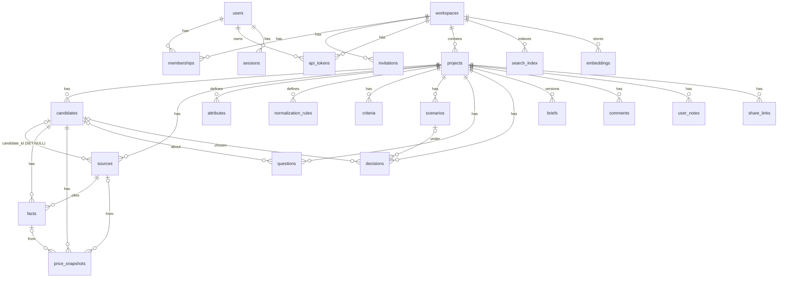

# DATA_MODEL — Selequo データモデル

本書は `src/server/db/schema.ts`（DDL）と `src/shared/types.ts`（共有型）を正とする。スキーマ変更時は両ファイルと本書を同時に更新すること（`schema.ts` 冒頭コメント参照）。

## 1. 概要

- DB: PostgreSQL 15+（本番、`pg`）／ PGlite（開発・テスト、組み込み WASM Postgres）。切替は `DATABASE_URL` の有無（`src/server/db/index.ts` `openDb`）。
- 拡張: `pg_trgm`（検索の類似度）。`pgvector` は使っていない。
- ID: すべて `text`（UUID 文字列、`newId()`）。
- 時刻: `timestamptz`。`deadline` / `review_date` のみ `date`。
- アクセスはパラメータ化クエリのみ（`Db.query/one/exec/tx`）。

### エンティティの流れ

```
Workspace → Project → Candidate → Source → Fact → Attribute → Criterion → Scenario → Question → Decision
                                     │        │                                            └→ Brief（版管理）
                                     │        └→ price_snapshots（価格履歴）
                                     └→ search_index / embeddings（検索）
```

## 2. ER 図



`audit_log` / `jobs` / `ai_calls` は `workspace_id` を持つが外部キーは張っていない（ワークスペース削除後も監査・台帳を残せる設計）。

## 3. テーブル別の主要カラム

| テーブル | 主要カラム | 備考 |
|---|---|---|
| `schema_meta` | `key`, `value` | `schemaVersion` を保持 |
| `users` | `email`(UNIQUE), `name`, `password_hash` | scrypt ハッシュ |
| `sessions` | `id`=sha256(token), `user_id`, `csrf_token`, `expires_at` | TTL 14 日（`SESSION_TTL_MS`） |
| `workspaces` | `ai_enabled`, `sharing_enabled`(既定 false), `external_search_enabled`, `is_sample` | テナント単位 |
| `memberships` | PK(`workspace_id`,`user_id`), `role` CHECK(owner/admin/editor/reviewer/viewer) | RBAC |
| `invitations` | `email`, `role`, `token_hash`, `expires_at`(7 日), `accepted_at` | メール送信は未実装（リンク共有） |
| `api_tokens` | `token_hash`, `scopes text[]`(read/write), `last_used_at`, `revoked_at` | MCP / 連携用。`slq_` 接頭辞 |
| `projects` | `title`, `category`, `purpose`, `deadline`, `status`, `currency`(JPY), `locale`, `ai_enabled`, `fact_policy`(confirmed_only), `default_params` jsonb | `status`: active/deciding/decided/archived |
| `candidates` | `name`, `provider`, `url`, `status` CHECK(considering/shortlisted/rejected/chosen), `tags`, `sort_order` | 作成時は常に considering |
| `sources` | `type` CHECK(web/pdf/screenshot/image/manual/csv/text), `url`, `file_key`, `mime`, `hash`, `quality`, `status`, `ai_enabled`, `extracted_text`, `pages` jsonb, `injection_flags` jsonb, `captured_at`/`retrieved_at`/`published_at`, `deleted_at` | 詳細は SOURCE_MODEL.md |
| `attributes` | UNIQUE(`project_id`,`key`), `display_name`, `type`(number/text/bool/price), `unit`, `category`, `aliases`, `group_name`, `origin`(catalog/suggested/user), `status`(active/suggested/removed) | 動的スキーマ |
| `normalization_rules` | `pattern`, `attribute_key`, `version`, `active`, `kind`='alias' | 旧版は無効化して保持 |
| `facts` | `candidate_id`, `source_id`(NOT NULL), `attribute_key`(NULL 可), `raw_label`, `raw_value`, `normalized_value` jsonb, `unit`, `issue`, `kind`(fact/opinion), `source_range` jsonb(NOT NULL), `confidence`, `review_state`, `extracted_by`, `reviewed_by/at`, `superseded_by`, `note` | 出典なしの Fact は作れない |
| `price_snapshots` | `amount`, `currency`, `tax`, `shipping`, `billing_period`, `contract_months`, `per_seat`, `seats`, `captured_at`, `fx_rate/base/source/at`, `source_id`, `fact_id` | 上書きせず履歴として追加 |
| `criteria` | `weight` numeric(0–100), `direction`, `must_have`, `target` jsonb, `linked_attributes`, `origin`, `status`(active/suggested) | |
| `scenarios` | `weights` jsonb, `must_haves` jsonb, `params` jsonb | SCENARIO_COMPARE.md |
| `questions` | `candidate_id`, `attribute_key`, `text`, `status`(open/answered/closed), `answer`, `answer_source_id`, `answer_fact_id` | |
| `decisions` | `chosen_candidate_id`, `scenario_id`, `reason`, `assumptions`, `expected_outcome`, `review_date`, `actual_result`, `lessons`, `status`(draft/decided/reviewed), `decided_by/at`, `reviewed_at` | 人の判断記録 |
| `briefs` | `version`, `content` jsonb(`selequo.brief/v1`), `review_state`(draft/in_review/approved) | スナップショット |
| `comments` | `entity_type`, `entity_id`, `body`, `author_id` | entity_type は fact/criterion/brief/candidate/source/decision/project |
| `user_notes` | `candidate_id`, `body` | Fact とは別管理。クライアント生成 ID でオフライン同期を冪等化 |
| `share_links` | `token_hash`, `expires_at`(1–90 日、既定 14), `revoked_at` | 読み取り専用ゲスト共有 |
| `search_index` | PK(`entity_type`,`entity_id`), `workspace_id`, `project_id`, `title`, `body` | ILIKE + `pg_trgm` GIN |
| `embeddings` | `model`, `vector` jsonb | **テーブルのみ。書き込み処理は未実装**（削除時のクリーンアップのみ実装） |
| `audit_log` | `actor_type`(user/token/share/system), `actor_id`, `action`, `entity_type/id`, `detail` jsonb | |
| `jobs` | `type`, `payload`, `status`(queued/running/done/failed), `attempts`, `run_after`, `last_error` | DB キュー（`src/server/jobs.ts`） |
| `ai_calls` | `provider`, `purpose`(extract/vision/answer), `input_chars`, `output_chars` | AI 利用台帳 |

### 値の表現（`src/shared/types.ts`）

- `NormalizedValue` = `{kind:'number',value,unit}` | `{kind:'text',value}` | `{kind:'bool',value}`。**Unknown は値の「不在」で表し、0 では表さない。**
- `SourceRange` は text / pdf / image / manual / csv の 5 種（SOURCE_MODEL.md）。

## 4. RBAC

ロールの序列は `ROLE_RANK`: owner 50 > admin 40 > editor 30 > reviewer 20 > viewer 10（`roleAtLeast`）。

`need(ctx, min)`（`src/server/services/core.ts`）は (1) ロールが `min` 以上か、(2) `min` が viewer 以外なら `write` スコープを持つか、を検査する。Cookie セッションは常に `['read','write']`、API トークンはトークンのスコープ。

### 権限マトリクス（`src/server/services/*.ts` の `need()` 呼び出しから導出）

| 操作 | Owner | Admin | Editor | Reviewer | Viewer |
|---|:-:|:-:|:-:|:-:|:-:|
| 一覧・詳細・比較表・Evidence・検索の閲覧（`need` なし。メンバーであることのみ要求） | ✓ | ✓ | ✓ | ✓ | ✓ |
| Research Assistant（`ask`、`need` なし） | ✓ | ✓ | ✓ | ✓ | ✓ |
| メンバー一覧、プロジェクト JSON エクスポート、read トークン作成（`viewer`） | ✓ | ✓ | ✓ | ✓ | ✓ |
| write スコープのトークン作成 | ✓ | ✓ | ✓ | ✓ | – |
| Fact の Confirm/Reject/Reopen・一括レビュー・Conflict 解決、質問の作成/回答、メモ、コメント、Brief のレビュー状態変更、監査ログ閲覧（`reviewer`） | ✓ | ✓ | ✓ | ✓ | – |
| プロジェクト作成/更新、候補 CRUD、ソース追加/更新/削除/再処理、手入力 Fact・Fact 再マップ、価格・為替、属性・正規化ルール、Criteria/Weight/Scenario、Decision 保存/振り返り、Brief 版作成、プロジェクト JSON インポート（`editor`） | ✓ | ✓ | ✓ | – | – |
| ワークスペース設定、メンバー招待・ロール変更・削除、プロジェクト削除、バックアップ、共有リンク、他人のトークン失効（`admin`） | ✓ | ✓ | – | – | – |
| Owner/Admin の付与・剥奪、Owner 招待、Admin の削除 | ✓ | – | – | – | – |

補足:
- 最後の Owner は降格できず、Owner は削除できない（`setMemberRole` / `removeMember`）。
- メンバー削除時、その人の API トークンはそのワークスペースで失効する。
- ワークスペース作成・バックアップ復元はログインユーザーなら誰でも可能（新しいワークスペースを作り Owner になる）。
- 判断の確定（`finalize`）と候補の `chosen` 設定は、ロールに関係なく **actor が `user`（画面操作）であること**が追加条件（DECISION_BRIEF.md）。
- 共有リンクのゲストは `role: 'viewer'`, `scopes: ['read']`, `actor.type: 'share'`。

## 5. テナント分離

1. テナント所有の全行が `workspace_id` を持ち、サービス層の全クエリが `workspace_id = ctx.workspaceId` で絞る。
2. `getProjectRow` / `assertInProject` が「ID が呼び出し元ワークスペース（と指定プロジェクト）に属すること」を確認し、属さなければ 404。
3. `ctxFor`（`src/server/app.ts`）はメンバーでないワークスペースに対して 403 ではなく 404 を返す（存在を明かさない）。
4. API トークンは 1 ワークスペースに束縛され、URL の `:ws` と一致しなければ 401。ロールは毎回 `memberships` から再解決されるため、現在のロールを超えない。
5. 検索インデックスはワークスペース単位で検索。ファイル保存キーは `ws/<workspaceId>/p/<projectId>/...`。
6. ジョブは `systemCtx(job.workspaceId)` で実行され、ジョブのワークスペースに限定される。
7. DB レベルの RLS（Row Level Security）は**未実装**。分離はアプリケーション層で担保している。

## 6. schemaVersion とマイグレーション

- `SCHEMA_VERSION = 1`（`schema.ts`）。起動時の `migrate()` が `SCHEMA_SQL`（`CREATE ... IF NOT EXISTS`）を実行し、`schema_meta.schemaVersion` を書き込む。
- 差分マイグレーション（v1→v2 の ALTER 等）の仕組みは**未実装**。将来スキーマを変える場合はマイグレーション手順の追加が必要。
- バックアップ（`src/server/services/backup.ts`）の manifest とプロジェクト JSON は `schemaVersion` を記録し、**現行より新しい版は復元/インポートを拒否**する。復元時は全 ID を再採番し、新しいワークスペースに入れる（共有は常に OFF）。
